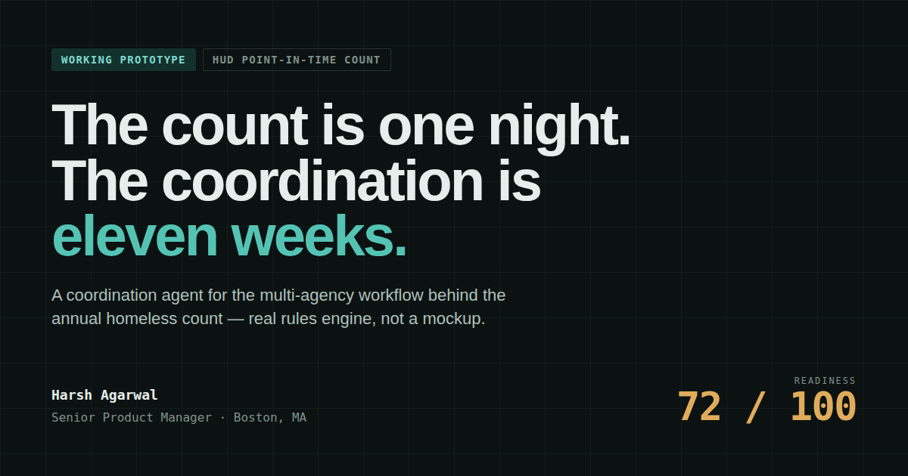

# PIT Count Command

A working prototype of a coordination agent for the **HUD Point-in-Time count** — the annual, federally mandated count of people experiencing homelessness that every Continuum of Care in the US runs on a single night in late January.

**[→ Live demo](https://harshagarwal2412-cell.github.io/pit-count-command/)**



---

## The problem

The count is one night. The coordination is eleven weeks.

A Continuum of Care coordinates thirty-plus partner organizations — shelters, street outreach teams, county agencies, faith groups, domestic violence providers, a HMIS lead — toward a single reference night between January 22 and 31. The work that determines whether the count is any good happens before it: confirming bed inventory, assigning geographic zones, recruiting volunteers who will show up in the cold, agreeing how DV provider data gets aggregated outside HMIS, and making sure every partner is running the current survey instrument.

That work is typically done in a spreadsheet and an inbox. Its failure mode is silence — the partner that goes quiet in week six, the rural zone short two teams, the subpopulation category nobody confirmed. These are invisible until they are expensive, and by count night they are unfixable.

## What this does

A rules engine reads the coordination state and surfaces what nobody thought to ask about.

Six rules run over the network and produce a weighted readiness score plus ranked findings, each with its evidence and a recommended action:

| Rule | What it catches |
|---|---|
| **R1** Zone coverage vs. prior-year population | Under-covered zones ranked by *people at risk*, not by size of the gap — and matched against zones carrying surplus, so the recommendation is "reassign" before "recruit" |
| **R2** Housing Inventory Count dependency | Bed-reporting partners who haven't confirmed inventory; the HIC shares the PIT's reference night and unconfirmed inventory becomes a sheltered-count discrepancy |
| **R3** HUD subpopulation coverage | Missing DV / youth / veteran / HMIS confirmation. DV providers cannot enter client-level data into HMIS, so the aggregate path has to be agreed in advance |
| **R4** Engagement decay | Days silent weighted by prior-cycle reliability, so a quiet partner that always delivers isn't treated like one that dropped last year |
| **R5** Survey instrument drift | Partners still on last cycle's instrument, whose records will be missing this cycle's fields — a failure that only surfaces during de-duplication, after the night |
| **R6** De-duplication exposure | Zones with three or more organizations canvassing without a documented street-level split |

The readiness score is a weighted composite: coverage 30%, staffing 25%, HIC 20%, compliance 15%, engagement 10%. Effective volunteer count applies an 18% count-night attrition assumption — a real deployment would learn that figure from the CoC's own history rather than defaulting it.

Findings that name a specific organization can generate a draft outreach message, composed from that org's actual record: what's missing, which zone it affects and how short that zone is, how long they've been silent, and the DV-specific note where it applies. One org in the sample data has no named contact in the CRM, and the draft says so rather than papering over it.

## It computes, it isn't canned

This is the part that separates a prototype from a mockup. The **Simulate a change** controls mutate the underlying records the way a real submission, confirmation, or the passage of time would. Re-run the scan and the score, the dimensions, and the findings all recompute.

Applying the full chain moves readiness from **72 → 94** and drops findings from six to four. Withdrawing two outreach partners takes it to **66**. Applying R1's own recommendation — splitting a college volunteer corps out of an over-covered zone — is one of the buttons, so you can watch the agent's advice take effect on its own scoreboard.

## Data

All synthetic. "Riverbend CoC" is not a real Continuum of Care, and no record here describes a real organization or person. The network is 34 partner organizations across 12 geographic zones, sized and distributed to reproduce the shape of the real problem: volunteer scarcity overall, and badly uneven distribution — a university district carrying 249% of the teams it needs while an encampment corridor with three times the population sits at 52%.

The rules themselves are drawn from HUD's published guidance:

- [PIT Count Planning Worksheet](https://files.hudexchange.info/resources/documents/PIT-Count-Planning-Worksheet.pdf)
- [PIT Count Methodology Guide](https://files.hudexchange.info/resources/documents/PIT-Count-Methodology-Guide.pdf)
- [Community Solutions — What is the Point-in-Time count?](https://community.solutions/what-is-the-point-in-time-count/)

## Running it

No build step, no dependencies, no server. One self-contained HTML file.

```bash
open index.html
```

Everything is inline — the rules engine, the data model, the rendering, and the styles. The only external request is Google Fonts.

## Stack

Vanilla HTML, CSS, and JavaScript. That's deliberate: the point of the prototype is that the coordination logic is legible and inspectable, and a framework would have buried it under scaffolding. `analyze()` is about 120 lines and is the whole argument.

## About

Built by **Harsh Agarwal**.

MIT licensed — see [LICENSE](LICENSE).
